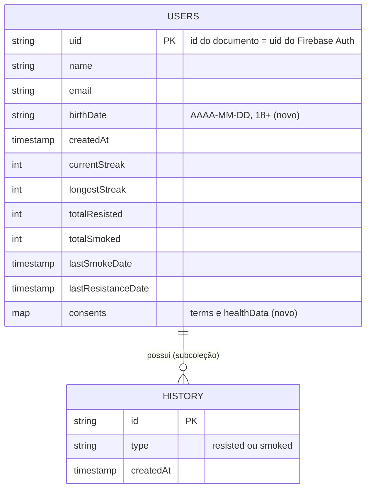

# Modelagem do banco de dados (Firestore), versão atualizada

Esta versão reflete o código atual do app, depois dos ajustes da banca. Ela substitui o [modelo anterior](Modelagem_Banco.pdf), que usava nomes de campos de uma fase anterior do projeto (por exemplo, `imagemUsuario` e `vezesNaoFumouHoje`, que o app não grava).

## Coleção `users/{uid}`

| Campo | Tipo | Descrição |
| --- | --- | --- |
| `name` | string | Nome ou apelido (até 100 caracteres) |
| `email` | string | Igual ao e-mail do login |
| `birthDate` | string `AAAA-MM-DD` | **Novo.** Data de nascimento; precisa indicar 18 anos ou mais e não pode ser alterada depois |
| `createdAt` | timestamp | Data do cadastro |
| `currentStreak`, `longestStreak` | int ≥ 0 | Sequência atual e maior sequência de dias |
| `totalResisted`, `totalSmoked` | int ≥ 0 | Contadores |
| `lastSmokeDate`, `lastResistanceDate` | timestamp ou null | Últimos registros |
| `consents.terms` | map `{version, acceptedAt}` | **Novo.** Aceite dos Termos de Uso e da Política de Privacidade |
| `consents.healthData` | map `{version, acceptedAt}` | **Novo.** Consentimento para dados de saúde (LGPD, art. 11, I) |

## Subcoleção `users/{uid}/history/{id}`

| Campo | Tipo | Descrição |
| --- | --- | --- |
| `type` | string | `resisted` (resistiu) ou `smoked` (recaída) |
| `createdAt` | timestamp | Data e hora do registro |

O histórico é dado de saúde. Ele só pode ser gravado se `consents` estiver registrado, e os registros não podem ser editados, apenas criados ou apagados. A exclusão de conta apaga a subcoleção inteira, o documento do usuário e o login. As regras completas estão em [`firestore.rules`](../../firestore.rules).
